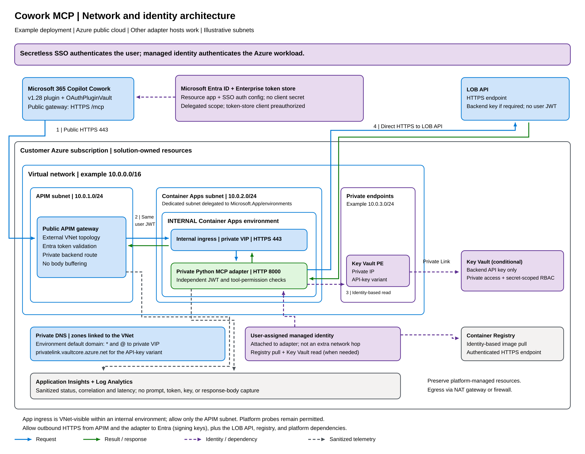

# Build and deploy a private MCP adapter for Cowork

This guide keeps the reviewed implementation's useful separation: MCP tool definitions, authentication, LOB API calls, Azure credential access, and deployment are different modules. It replaces the domain-specific operations with one illustrative catalog lookup.

The worked example hosts the adapter on Azure Container Apps. Azure App Service (with VNet integration and access restrictions), AKS, or another host works too, as long as it is reachable only through the gateway and supports a managed identity or equivalent workload identity.

> [!IMPORTANT]
> The files in `examples` are integration examples, not a complete web application. There is no turnkey infrastructure template, authenticated ASGI entry point, real catalog endpoint, image, or deployable ZIP in this article set. Implement the missing contracts below before deploying. Do not run the original application's provisioning scripts as a substitute: their application dependencies differ from this pattern.

## 1. Define a bounded LOB operation

Choose a stable read-only operation before creating its MCP tool. Expose a narrow lookup rather than a general-purpose request tool. For example:

| Contract item | Example decision |
| --- | --- |
| MCP tool | `catalog_get_record` |
| Input | Strict `record_id` string, 1-64 letters, digits, underscores, or hyphens. |
| Backend action | One lookup against a fixed, configured HTTPS LOB API origin. |
| Result | Object containing the record and response metadata. |
| Time budget | 15 seconds for the complete operation, including credential retrieval and response consumption. |
| Structured result JSON limit | 262,144 UTF-8 bytes before the MCP envelope; text and structured content duplicate this data on the wire. |
| Failure behavior | Explicit `isError: true`; no partial data, silent fallback, automatic retry, or inferred "not found". |

These are illustrative application choices adapted from the source's bounded-call design, not Cowork platform limits or the source service's data schema. Select limits that meet your real service contract.

The accompanying [catalog_tools.py](examples/catalog_tools.py) registers this actual tool with the MCP Python SDK:

```python
server = FastMCP(
    "contoso_catalog",
    stateless_http=True,
    json_response=True,
    streamable_http_path="/mcp",
)
```

It uses `ToolAnnotations` to describe the operation as read-only, with a `title` that Cowork shows to users. Cowork reads these annotations: where annotation-driven confirmation is available (it's rolling out progressively for non-Microsoft MCP servers), Cowork asks the user to confirm a tool whose `readOnlyHint` is false or whose `destructiveHint` is true, and treats unannotated tools as destructive. Annotations shape the experience only; they aren't authorization. The tool checks the authenticated principal before calling the backend and returns both text content and `structuredContent`, matching the reviewed implementation's MCP result pattern.

The injected `CatalogBackend` is deliberately unimplemented. It must enforce:

- A fixed HTTPS origin and allowlisted path/method; don't accept a complete URL from the model.
- Strict input and upstream-response validation, including business-level not-found behavior.
- Path-segment escaping where the real contract needs it.
- No redirects carrying credentials to another origin.
- A byte cap **while reading** the upstream response, not only after allocating it.
- An explicit content-encoding/content-type policy, bounded connect/read timeouts, and an overall deadline.
- Sanitized, classified failures. No raw upstream response, exception detail, key, or user token in errors/logs.

The sample's final serialization cap doesn't replace the backend's streaming cap. Reject unsupported data rather than trimming it and claiming success.

## 2. Implement the authenticated HTTP boundary

Host the SDK's `streamable_http_app()` inside an ASGI application and run `server.session_manager.run()` for the application's lifespan. Register `/healthz`, `/readyz`, and protected-resource metadata separately.

Implement middleware that validates tokens using a maintained JWT library and tenant-specific Entra discovery. Cache signing keys with bounded refresh behavior. Fix allowed algorithms and trusted discovery locations; don't trust a signing-key URL supplied in a token header. Apply every check in [the SSO authorization table](configure-secretless-sso.md#5-align-audiences-and-authorization).

Only after validation, populate `request.state.principal` with the sample's `CatalogPrincipal`. Derive its tool permissions from the validated delegated scope: `catalog.read` grants `lookup`. Never construct that principal from unverified claims or forwarded identity headers. Reject missing/invalid tokens with HTTP 401 before the SDK runs. Authentication middleware is **not included** in the sample.

Keep these behaviors explicit:

| Surface | Behavior |
| --- | --- |
| `/mcp` | Authenticated MCP Streamable HTTP; preserve POST, GET, and DELETE routing. Stateless operation doesn't imply every method succeeds: the SDK can reject unsupported session actions. |
| `/healthz` | Cheap process liveness, no LOB API call. Internal platform probes only. |
| `/readyz` | Bounded checks for signing-key readiness and credential-provider access; no LOB lookup. Internal platform probes only. |
| `/.well-known/oauth-protected-resource/mcp` | Public nonsecret metadata; does not authorize tool access. |
| Origin handling | Reject unapproved Origin headers. Don't use wildcard CORS as a substitute for authentication. |
| Error handling | HTTP authentication errors at the boundary; MCP `isError` for authorized calls that fail. |

An authenticated SDK request still requires per-tool authorization. The sample denies a missing principal and a principal without `lookup` permission before touching the backend.

## 3. Retrieve backend credentials with managed identity

For an API-key LOB API, give the adapter a user-assigned managed identity. Grant **Key Vault Secrets User** at the intended secret scope and image-pull rights at the registry. The reference uses `AcrPull` for a registry using conventional RBAC; ABAC-enabled registries need the applicable repository-read roles instead.

Example SDK construction, adapted from the source runtime:

```python
from azure.identity.aio import ManagedIdentityCredential
from azure.keyvault.secrets.aio import SecretClient

credential = ManagedIdentityCredential(client_id=managed_identity_client_id)
secrets = SecretClient(vault_url=vault_url, credential=credential)
```

This is a construction excerpt: supply validated nonsecret configuration and close both clients in the ASGI lifespan. The real provider reads the configured secret at runtime, validates its enabled/time-valid state, and passes it only to the fixed backend destination. Keep Azure HTTP logging disabled and don't log the returned value.

Import the backend key through your approved Key Vault process. A private vault requires an operator or deployment agent with private-network reachability and secret-write permission; signing into Azure portal alone doesn't provide that network path. Don't open the vault to the internet just to complete setup. No key file, environment-value example, shell argument, package, or screenshot should contain the key.

See [Key Vault RBAC](https://learn.microsoft.com/en-us/azure/key-vault/general/rbac-guide) and [managed identities in Container Apps](https://learn.microsoft.com/en-us/azure/container-apps/managed-identity).

The recommended runtime configuration is illustrated in [runtime-settings.example.json](examples/runtime-settings.example.json). Its fields are a **documentation contract**, not an input accepted by either reviewed project's CLI. Values are references/identifiers, not secrets.

## 4. Prepare the Azure foundation

Review resource ownership, network design, and cost before provisioning. Create your own infrastructure modules or use an organization-approved baseline for:

1. A dedicated resource group, VNet, APIM subnet, delegated Container Apps subnet, and private-endpoint subnet.
2. Public APIM with private connectivity to the adapter. For the reference topology, classic Developer uses external VNet injection. Choose production tiers/network features deliberately rather than changing only the SKU string.
3. An **internal** Container Apps workload-profile environment. Configure the environment's private DNS zone, VNet link, and resolution to its internal load-balancer address.
4. A registry, user-assigned identity, Key Vault, and Key Vault private endpoint/DNS.
5. Log Analytics and appropriate application telemetry with request/response payload capture disabled.
6. Outbound access. APIM and the adapter both fetch Entra discovery documents and signing keys from `login.microsoftonline.com`, and the adapter calls the LOB API. If you route egress through a NAT gateway, Azure Firewall, or user-defined routes, allow those destinations along with the platform's required dependencies. A blocked key fetch shows up as every request failing with HTTP 401 or 500.

Enable the resource providers required by your chosen resource types through approved subscription administration. Retain the platform's required DNS, control-plane, and image-pull dependencies in network rules.



*The gateway is public; the adapter is private. The Key Vault branch applies when the LOB API needs a stored credential. Illustrative subnets don't replace a reviewed network plan. Preserve platform-managed infrastructure.*

[Full-size PNG](diagrams/cowork-mcp-network.png) | [Editable Excalidraw source](diagrams/cowork-mcp-network.excalidraw)

Use deployment validation and what-if on **your completed templates**. Review the actual plan before applying it. There are no supplied `foundation.bicep` or deployment-runner commands to execute from this article folder.

Don't remove platform-owned infrastructure, such as the Container Apps managed resource group or storage service endpoints required by APIM.

## 5. Stage the gateway closed

Before adding a live backend, create the intended API route in a disabled state. A safe new-route sequence is: create an empty subscription-gated API with no live upstream or operations, apply and verify a deny policy, then attach its backend/operations while retaining the deny policy. Disable subscription requirements only when the final Entra policy is ready.

Don't rely on an eventually applied authentication policy to protect an initially open route. For a shared APIM service, preserve inherited policies, diagnostics, unrelated APIs, and ownership records. The policy example retains `<base />`; review the effective policy to avoid duplicate forwarding or inherited body buffering.

For this custom adapter, create a regular HTTP API:

| APIM setting | Value |
| --- | --- |
| API identifier | `catalog-mcp` |
| API URL suffix | `mcp` |
| Backend service URL | `https://<private-container-app-fqdn>` |
| Operations | POST, GET, DELETE at `/` |
| Rewrite | `/mcp`, without forwarding unmatched query parameters |
| Subscription required after activation | No; Entra is required instead |

Only expose the metadata operation outside the authenticated API. The source implements it as an API with an empty suffix and an explicit `/.well-known/oauth-protected-resource/mcp` operation; check route collisions on shared gateways.

Use [apim-policy.xml](examples/apim-policy.xml) as a policy template. Replace **every** `__...__` token using validated values and XML escaping. It uses Microsoft's recommended `validate-azure-ad-token` policy with the token-store client restriction, tenant, v2 token version, delegated scope, and same-resource audiences. It has no per-user list: to limit users, use Entra assignment as described in [Limit who can use the connector](configure-secretless-sso.md#optional-limit-who-can-use-the-connector).

The example is for this regular HTTP proxy, not a native APIM MCP resource. Verify it in your chosen APIM tier before production. It forwards the user token to the private adapter unchanged, leaves response buffering off, and doesn't inspect response bodies.

Publish metadata matching [oauth-resource.example.json](examples/oauth-resource.example.json). Its `resource` must equal the connector URL; its issuer must match your tenant; its scope uses the registered SSO resource URI. On HTTP 401, the gateway challenge points to this metadata URL.

> **Image placeholder - Verify the private network boundary**  
> Intended screenshot: Internal Container Apps environment settings next to the app's IP restriction allowing only the APIM subnet. Use redacted resource labels.  
> Alt text: "Internal Container Apps environment and an ingress rule allowing the APIM subnet."  
> Caption: "The public gateway is the entry point; the backend isn't publicly reachable."

## 6. Build and deploy the application

1. Build your completed adapter as a Python wheel. Keep dependency declarations and the generated Linux dependency lock consistent; remove unused dependencies rather than carrying over a source lock unchanged.
2. Build a Linux image from the wheel with a supported, reviewed base-image digest and locked dependencies. Use a minimal nonroot runtime, no build tools or customer configuration in the final layer, and no credentials in the build context.
3. Verify tool registration and startup offline. Push the approved image to your registry using your organization's normal identity-based process, then record its digest.
4. Deploy by digest to Container Apps with the user-assigned identity and registry pull configuration. Set the app's target port to `8000`, TLS-only ingress, liveness/readiness/startup probes, and the validated runtime settings.
5. Use app ingress visible to the VNet, with an APIM-subnet allow rule, inside the **internal** environment. `ingress.external: true` at app level does not make an internal environment publicly accessible; setting it false would limit ingress to the same Container Apps environment and can block APIM.
6. Verify readiness, private DNS, identity grants, and token validation while the public API remains denied. Then apply the reviewed authenticated gateway policy and test the negative cases immediately.

One worker, one replica, and single-revision mode can simplify initial operations. Size and scale the service against the LOB API's concurrency and quota contract.

Retain a known-good image digest and policy for rollback. Image rollback alone won't undo identity, schema, or configuration changes. Do not perform automatic broad deletion on a failed deployment.

Continue with [package and acceptance validation](package-and-validate.md).
