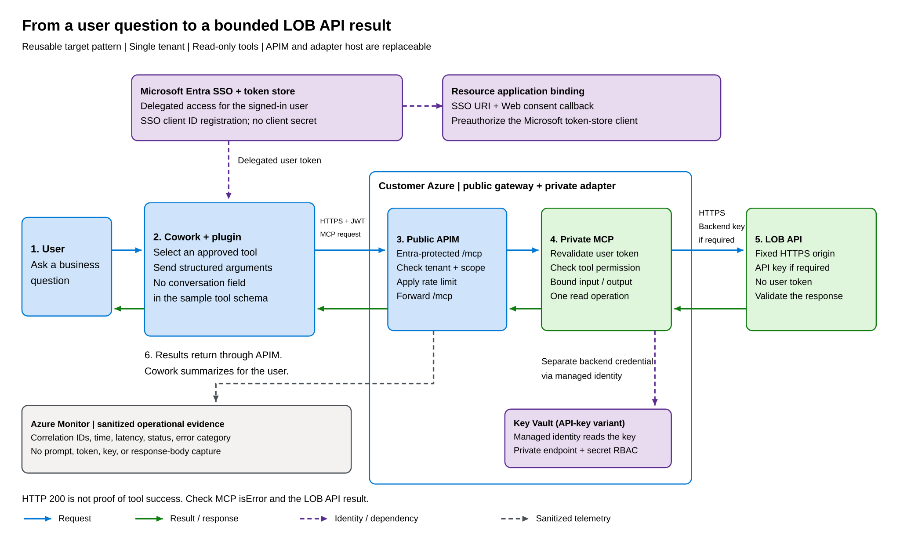

# Build a Copilot Cowork plugin for a line-of-business API that uses an API key

**Applies to:** Microsoft 365 Copilot

Many line-of-business (LOB) APIs accept only an API key. Copilot Cowork connectors don't support API-key authentication yet, so a Cowork plugin can't call those APIs directly. For details, see [Supported auth types](https://learn.microsoft.com/en-us/microsoft-365/copilot/cowork/cowork-plugin-development).

This article shows a reference pattern that closes the gap:

- Users sign in with their Microsoft 365 account through **Microsoft Entra single sign-on (SSO)**. You don't create a client secret for this connection.
- Cowork calls an **Entra-protected Model Context Protocol (MCP) endpoint** that you publish through Azure API Management (APIM).
- A private **MCP adapter** reads the API key from Azure Key Vault and calls the LOB API. The key never appears in the plugin package and never reaches Cowork.

The examples use a fictional, read-only **Contoso Catalog** API. Replace it with your own API.

## Do you need this pattern?

Start with how your existing backend authenticates. In every case, the URL that you put in the plugin is an Entra-protected MCP endpoint, never the LOB API itself.

| Your backend | What to do |
| --- | --- |
| **REST API that uses an API key** (in a header or query string) | **Use this pattern.** If your operations are simple and already return suitable results, you can use [APIM's REST-to-MCP export](https://learn.microsoft.com/en-us/azure/api-management/export-rest-mcp-server) instead of a custom adapter. |
| **REST API protected by Microsoft Entra ID** | Use this pattern, because Cowork needs an MCP endpoint. The adapter calls the API with its managed identity, or with an [on-behalf-of](https://learn.microsoft.com/en-us/entra/identity-platform/v2-oauth2-on-behalf-of-flow) token if the API must know the user. It doesn't need Key Vault. |
| **MCP server that uses an API key** | Keep your server. Put an [APIM MCP proxy](https://learn.microsoft.com/en-us/azure/api-management/expose-existing-mcp-server) in front of it to validate Entra tokens and add the key as a header or query parameter. You don't need a custom adapter. |
| **MCP server protected by Microsoft Entra ID** | You don't need this pattern. Configure Entra SSO and point the plugin at your server. Add APIM only if you want central policies, rate limits, or private networking. |

## How it works



1. A user asks Cowork a question that needs data from the LOB API.
2. Microsoft 365 gets an Entra access token for the user from the Microsoft Enterprise token store. The first time, the user signs in or consents.
3. Cowork sends the MCP request, with the token, to your APIM endpoint.
4. APIM validates the token and forwards only valid requests to the private adapter.
5. The adapter validates the token again, reads the API key from Key Vault with its managed identity, and calls one approved LOB API operation.
6. The adapter returns a bounded result, or a clear error, and Cowork uses it to complete the task.

| Component | Role |
| --- | --- |
| Cowork plugin | Tells Cowork the connector URL and which SSO registration to use. Contains identifiers only, no credentials. |
| Microsoft Entra ID | Signs the user in and issues a token for your API. |
| Azure API Management | The public, Entra-protected MCP endpoint. Validates tokens and applies rate limits. |
| MCP adapter | A small private service that defines the tools, validates input and output, and calls the LOB API. This example uses Azure Container Apps; Azure App Service or another private host also works. |
| Azure Key Vault | Stores the API key. The adapter reads it with a managed identity. |

> [!IMPORTANT]
> The user's token controls who can call the connector. The API key controls what the adapter can read. Every user who can sign in gets the **same** access to the LOB API. Use this pattern for read-only data that all users are allowed to see. If results must differ by user, add per-user checks in the adapter or use on-behalf-of.

## Prerequisites

| Who | Needed for |
| --- | --- |
| Microsoft Entra administrator | Registering the API, exposing a scope, and granting consent |
| Azure administrator | Deploying APIM, the adapter host, and Key Vault |
| Developer | Building the adapter and packaging the plugin |
| Microsoft 365 administrator | Deploying the plugin to users |

You also need:

- Copilot Cowork and Microsoft 365 Copilot licenses, and a test tenant that allows custom plugins.
- Access to the LOB API, its API contract, and an approved process for storing its API key.
- Network access from APIM and the adapter to `login.microsoftonline.com` (for token signing keys) and to the LOB API.
- An APIM tier that supports your policies. The example uses `rate-limit-by-key`, which the Consumption tier doesn't support.
- Your publisher name, privacy and terms URLs, and app icons.

## Step 1: Register your API in Microsoft Entra ID

1. In the Microsoft Entra admin center, go to **App registrations** > **New registration**.
2. Create a single-tenant app, such as **Contoso Catalog MCP**. Copy its **Application (client) ID**.
3. Under **Expose an API**, set an Application ID URI, such as `api://<client-id>`, and add a delegated scope, such as `catalog.read`, with the display name *Read Contoso Catalog records*.
4. In the app manifest, set `api.requestedAccessTokenVersion` to `2`.

## Step 2: Create the Microsoft Entra SSO registration

The SSO registration lets the Microsoft Enterprise token store get tokens for your API on the user's behalf. You can create it with Microsoft 365 Agents Toolkit, the `declarative-agent-developer` skill in Microsoft Work IQ, or Teams Developer Portal. All three create the same registration, and you can manage it later in Teams Developer Portal. For details, see [Configure Microsoft Entra SSO authentication](https://learn.microsoft.com/en-us/microsoft-365/copilot/extensibility/plugin-authentication-entra-sso).

To use Teams Developer Portal:

1. Go to [Teams Developer Portal](https://dev.teams.microsoft.com/tools) > **Tools** > **Microsoft Entra SSO client ID registration**, and select **Register client ID**.

   > [!IMPORTANT]
   > Choose **Microsoft Entra SSO client ID registration**, not **OAuth client registration**. The OAuth option asks for a client secret.

2. Enter these values:

   | Field | Value |
   | --- | --- |
   | Base URL | Your APIM endpoint, such as `https://<gateway-host>/mcp` |
   | Restrict usage by org | Your organization |
   | Restrict usage by app | Your plugin's app ID, or **Any Teams app** until you have one |
   | Client ID | The Application (client) ID from step 1 |
   | Scope | `catalog.read`. Add `offline_access` so tokens can refresh without sign-in. If you get an invalid-scope error, use the full form `<Application ID URI>/catalog.read`. |

3. Select **Save**, and copy the two values that the portal returns:
   - **Microsoft Entra SSO registration ID**: you put this in the plugin as `referenceId`. It's an identifier, not a secret.
   - **Application ID URI**: you add this to your Entra app in step 3.

> **Image placeholder:** Teams Developer Portal showing the completed SSO registration form and the returned registration ID and Application ID URI. Redact real identifiers.
> Alt text: "Microsoft Entra SSO client ID registration with the APIM URL, client ID, and scope."

## Step 3: Finish configuring your Entra app

The registration isn't complete until your Entra app trusts it. Go back to the app from step 1:

1. **Add the Application ID URI** from step 2. In the app manifest, add it to `identifierUris` and keep the existing value.
2. **Add the consent redirect URI.** Under **Authentication**, add a **Web** platform redirect URI: `https://teams.microsoft.com/api/platform/v1.0/oAuthConsentRedirect`.
3. **Preauthorize the token store.** Under **Expose an API** > **Add a client application**, enter the Microsoft Enterprise token store client ID `ab3be6b7-f5df-413d-ac2d-abf1e3fd9c0b`, and select `catalog.read`.

> **Image placeholder:** The Entra app showing the added Application ID URI, the Web redirect URI, and the authorized token store client.
> Alt text: "Entra app with the SSO Application ID URI, consent redirect URI, and preauthorized token store client."

## Step 4: Build and deploy the adapter and gateway

**Adapter.** Build a small MCP server with the [MCP Python SDK](https://github.com/modelcontextprotocol/python-sdk) or another MCP SDK. See [catalog_tools.py](examples/catalog_tools.py) for a sample tool. Follow these rules:

- Expose specific, read-only tools, such as *get catalog record by ID*. Don't expose a general "fetch any URL" tool.
- Validate inputs, call a fixed LOB API address, and limit time and response size.
- Send the API key the way the LOB API expects it: in a request header (for example, `x-api-key`) or in a query string parameter (for example, `?api_key=`). Prefer a header when the API supports both. Query strings can be recorded in URL logs, so never log the full upstream URL.
- Return a clear error when something fails, rather than an empty result.
- Set `readOnlyHint: true`, `destructiveHint: false`, and a `title` on each read-only tool. Cowork shows the title, and can ask users to confirm tools that aren't marked read-only.

**Hosting.** Run the adapter where only APIM can reach it, such as an internal Azure Container Apps environment. Give it a managed identity with **Key Vault Secrets User** on the API key secret.

**Gateway.** In APIM, publish `/mcp` and use the [validate-azure-ad-token](https://learn.microsoft.com/en-us/azure/api-management/validate-azure-ad-token-policy) policy. See [apim-policy.xml](examples/apim-policy.xml). Both APIM and the adapter must check:

| Check | Expected value |
| --- | --- |
| Tenant (`tid`) | Your tenant ID |
| Audience (`aud`) | Your API's client ID. Version 2 tokens use the client ID, not the Application ID URI. Also accept the Application ID URI from step 2. |
| Calling client (`azp`) | The token store client ID `ab3be6b7-f5df-413d-ac2d-abf1e3fd9c0b` |
| Token version (`ver`) | `2.0` |
| Scope (`scp`) | Contains `catalog.read` |

Don't disable audience or issuer checks to fix an error. Don't forward the user's token to the LOB API.

## Step 5: Package the plugin

A Cowork plugin is a Microsoft 365 app package. Add your connector to `manifest.json`. The `authorization` block uses `OAuthPluginVault` with the SSO registration ID from step 2:

```json
{
  "agentConnectors": [
    {
      "id": "catalog-mcp",
      "displayName": "Contoso Catalog",
      "description": "Read approved catalog records.",
      "toolSource": {
        "remoteMcpServer": {
          "mcpServerUrl": "https://<gateway-host>/mcp",
          "mcpToolDescription": { "file": "tools/catalog-tools.json" },
          "authorization": {
            "type": "OAuthPluginVault",
            "referenceId": "<SSO registration ID>"
          }
        }
      }
    }
  ]
}
```

For the full file, see [manifest.example.json](examples/manifest.example.json).

- Cowork discovers tools from your server at runtime. With manifest version 1.28, you must still include the tool description file named in `mcpToolDescription`. Generate it from your adapter so it matches. With version 1.29, which `wiqd plugin create` uses, the file is optional.
- To teach Cowork how to use your tools, add a skill folder and list it in `agentSkills`.
- Zip `manifest.json`, the icons, the tool description file, and the skill folder together.

## Step 6: Test the plugin

In Cowork, go to **Customize** > **Plugins** > **Add plugin**, select your package, and choose **Only you**. Then test these cases:

| Test | Expected result |
| --- | --- |
| First use | You're asked to sign in or consent once, and the tool runs. |
| Known record | Cowork answers with data from the LOB API. |
| Unknown record | Cowork reports that the record wasn't found. |
| LOB API unavailable | Cowork reports an error, not an empty result. |
| Call the endpoint without a token, or with a token for another API | APIM returns HTTP 401. |
| Later use | No sign-in prompt until your tenant's session policy requires one. |

## Step 7: Deploy to your organization

1. Upload the package in the Microsoft 365 admin center: go to **Manage apps** > **Upload custom app**, then select **...** > **Add agent**.
2. Go to **Agents** > **Tools**, select the plugin, and choose who gets it: all users or specific users and groups.

For details, see [Manage plugins for Copilot Cowork](https://learn.microsoft.com/en-us/microsoft-365/copilot/cowork/cowork-manage-plugins).

### Limit who can call the API

By default, anyone in your organization who signs in and consents can call your MCP endpoint, even if they got the plugin from a colleague. To restrict the endpoint itself, open the Entra **Enterprise application** for your API, set **Assignment required** to **Yes**, and assign a security group. Entra then doesn't issue tokens to anyone outside that group.

## Troubleshoot

| Symptom | Likely cause |
| --- | --- |
| The portal asks for a client secret | You chose OAuth client registration. Use Microsoft Entra SSO client ID registration. |
| Sign-in fails with an invalid resource or scope | The Application ID URI from step 2 isn't in `identifierUris`, or the Scope field needs the full URI form. |
| The consent prompt keeps appearing | The redirect URI or token store preauthorization from step 3 is missing. |
| HTTP 401 from APIM | A token check fails. Compare the expected values in step 4. Most often, `aud` is the client ID, not the Application ID URI. |
| Every request fails, even with valid tokens | APIM or the adapter can't reach `login.microsoftonline.com` to download signing keys. |
| HTTP 502 | APIM can't reach the adapter. Check private DNS and network rules. |
| HTTP 200 but the tool failed | The MCP result has `isError: true`. Check the adapter logs by correlation ID. |
| Cowork asks to confirm a read-only tool | The tool is missing `readOnlyHint: true`. |

Don't log tokens, API keys, or request content.

## Limitations

- This is a reference pattern, not a Microsoft product. You own and operate the adapter and the Azure resources.
- The example covers read-only lookups in a single organization in Azure public cloud. Add writes, exports, paging, or retries only with their own permissions and testing.
- APIM rate limits control incoming traffic. They don't guarantee that you stay within the LOB API's quotas.

## Related content

- [Build plugins for Copilot Cowork](https://learn.microsoft.com/en-us/microsoft-365/copilot/cowork/cowork-plugin-development)
- [Manage plugins for Copilot Cowork](https://learn.microsoft.com/en-us/microsoft-365/copilot/cowork/cowork-manage-plugins)
- [Configure Microsoft Entra SSO authentication](https://learn.microsoft.com/en-us/microsoft-365/copilot/extensibility/plugin-authentication-entra-sso)
- [Expose a REST API in API Management as an MCP server](https://learn.microsoft.com/en-us/azure/api-management/export-rest-mcp-server)
- [Expose an existing MCP server in API Management](https://learn.microsoft.com/en-us/azure/api-management/expose-existing-mcp-server)
- [Networking in Azure Container Apps](https://learn.microsoft.com/en-us/azure/container-apps/networking)
- [Copilot Developer Camp: Add Entra SSO to a Cowork plugin](https://microsoft.github.io/copilot-camp/pages/copilot-cowork/03-cowork-plugins-sso/)
